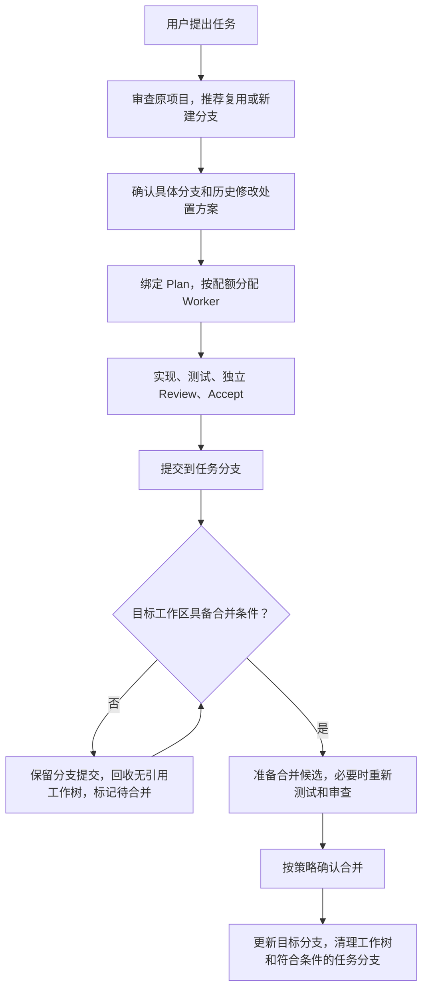

# Agent Orch 0.8.3 分支与工作区生命周期方案

> 本文保留 2026-11-04 的原始暂存方案。用户随后批准实现；0.8.3 的最终范围、
> 兼容边界和验证说明见 [实现说明](../releases/0.8.3.md)。下方状态为保存当日状态。

- 状态：方案暂存，尚未实施。
- 目标版本：预计 0.8.3；不是已完成或已发布的功能。
- 保存日期：2026-11-04（Asia/Singapore）。
- 当前基线：0.8.2。
- 用户指示：先保存本方案，预计在 0.8.3 实现；本次不启动实现、不改变代码或运行配置。

## 目标

初始化和环境审查时，根据任务情况推荐复用或新建分支，并明确提交、合并与清理时点，同时控制 worktree 数量。

推荐流程：先推荐并绑定任务分支，按配额使用 worktree；验收后提交，合并条件满足后再合并。可恢复的成果不必一直占着工作目录。

## 1. 分支按可独立交付的变更管理

一个功能可能经历多个 Plan、Worker 和修复轮次，通常共用一个任务分支。分支不按会话或 Worker 数量创建。

| 实际情况 | 推荐 |
|---|---|
| 只读查询、审查、诊断 | 不创建分支或 worktree |
| 继续同一功能，已有归属明确的任务分支 | 复用该分支 |
| 当前在主分支，准备实现独立功能或修复 | 新建 `codex/<任务简称>` |
| 当前分支包含另一个任务的独立成果 | 保留原分支，为新任务建分支 |
| 分支归属、历史提交用途不明确 | 先审查，不能仅凭分支名称判断 |
| 同一功能由多个 Worker 并行实现 | 共用任务分支；Worker 保持隔离，统一集成 |
| 多项独立任务并行 | 各自任务分支，串行合并到目标分支 |

目标分支从项目配置、现有分支和本地远程引用中识别；无法确定时询问，不固定假定为 `main`。

新建分支本身不创建额外目录，也不会消除未提交修改。

## 2. 初始化给出完整推荐，减少反复询问

初始化或环境审查后，主会话展示一份完整方案。以下仅为界面示例，不是当前项目已采用的配置：

| 项目 | 推荐内容示例 |
|---|---|
| 目标分支 | `main`，附当前提交 |
| 任务分支 | 新建 `codex/git-branch-lifecycle` |
| 推荐理由 | 当前位于目标分支，本任务可独立交付 |
| 历史修改 | 分组说明保留、提交或归档哪些内容 |
| Worker 基线 | 已提交版本，或明确批准的历史修改 |
| 提交策略 | 验收后自动本地提交 |
| 合并策略 | 完成后确认一次 |
| 清理策略 | 满足安全条件后自动回收 |
| 工作区上限 | 默认 2 个 Worker、1 个集成槽位，总数不超过 3 |

提供一组选项：**使用推荐／修改推荐／仅审查**。需要修改时，只询问选中的字段。

新项目可推荐“验收后自动提交、合并前确认、安全清理自动”。已有项目沿用现有策略，升级不得擅自把 `commit_policy: ask` 改成自动提交。

接受推荐只授权其中列明的本地操作，不包含推送、发布或提交未知历史修改。

## 3. 脏 Git 先明确归属与处置

继续使用现有环境审查与收敛机制，并与分支推荐关联：

- 与当前任务无关：保留原文件及暂存状态；Worker 从批准的提交开始。
- 当前任务依赖这些修改：明确哪些内容纳入基线，不能静默遗漏，也不能自动全部收进去。
- 已完成且证据充分：经授权后精确提交。
- 未完成但需要腾出目录：保存 WIP、暂存／未暂存补丁，再按批准方案处理。
- 存在冲突、未完成 Git 操作或无法判断的独立提交：先阻塞相关操作。

有脏修改或活跃任务时，不自动切换主工作目录的分支。可以先创建任务分支引用，让 Worker 在受管 worktree 中工作。

## 4. 明确提交时点

| 阶段或情况 | Git 处理 |
|---|---|
| Worker 仍在实现、测试失败、Review 未通过 | 不生成已验收交付提交 |
| 一个可独立验收的里程碑完成 | 提交到任务分支 |
| 多个并行 Worker 完成 | 先保存各自结果，再集成、重新审查并提交 |
| 暂停或放弃未验收任务 | 保存明确标记的 WIP，不冒充交付 |
| 修改归属不明、混入其他任务 | 不自动提交 |
| 实验开始前，运行代码和协议已验收 | 提交代码、配置和协议 |
| 训练过程中产生权重、缓存、逐轮日志 | 按制品策略保存，通常不进入 Git |
| 实验结束，报告和结果核验完成 | 提交应跟踪的报告、清单及代码变更 |

Worker 不直接抢写共享分支。提交由协调流程串行完成，执行正常的 Git hooks，并记录准确文件、提交和验收凭据。

## 5. 分开已提交与已合并状态

建议状态流：

`实现中 → 待审查 → 已验收 → 已提交待合并 → 已合并 → 已清理`

成果已可靠提交，但目标分支暂时不能合并时，可以先回收 worktree，只保留分支、Git 对象和证据。

合并规则：

- 目标提交未变化、结果可直接快进：复用已有验收证据，准备具体合并操作。
- 目标分支已经前进：在现有或预留集成工作树中准备新结果，重新测试、Review、Accept。
- 有冲突：保留现场，解决后重新审查。
- 目标目录仍有未妥善处理的修改：保持已提交待合并，不自动 stash。
- 更新目标分支前，再检查目标提交、工作区状态及未跟踪／忽略文件的路径冲突。

默认不自动 rebase 或改写历史。准备好可审查的合并候选后，再进行最终合并确认。

任务分支和目标分支必须属于同一 Git 仓库。登记为同一逻辑项目的独立协调副本，不因此获得跨仓库直接合并权限。

## 6. 分支删除与目录清理采用不同门槛

回收 worktree 需要：

- 没有 Worker、Reviewer、训练进程或其他任务仍引用它。
- 成果已提交并可恢复，或者已获准保存为 WIP。
- 没有未保存的独有文件、未解决冲突或遗漏修改。
- 证据和日志已保存在工作树之外。

删除任务分支还需要：

- 分支由插件创建并有归属记录。
- 当前分支提交没有被别人推进。
- 已确认成果进入目标分支，或获准以 WIP 归档后退役。
- 不是受保护分支或用户原有分支。

复用的用户分支默认保留。任务记录、审查证据和日志不随目录删除。

0.8.2 的清理门禁主要围绕已交付结果。实现时必须正式增加“已提交待合并”的可恢复证明，不能直接放宽现有检查。

## 7. 并行任务与 worktree 配额统一调度

保留跨协调副本共享配额，并增加集成槽位预留：

- 默认最多 2 个 Worker、1 个集成工作树，总额外目录不超过 3。
- 只读 Reviewer 复用被审查目录，不额外占目录。
- 同一任务续接、修复、模型升级复用原工作树。
- 已登记协调副本、外部 Git worktree 也占用总名额。
- 有并行任务需要集成时，提前预留集成槽位，避免所有槽位被 Worker 占满。
- 已有副本占用名额时，降低可启动的 Worker 数量；不自动提高上限。
- 满额时排队，或提出具体清理建议，不复制新仓库绕过。
- 大型数据、依赖和缓存使用明确的外部位置，避免每份工作树重复携带。

同一任务分支只有一个提交写入者。多个任务合并到同一目标分支时，串行检查和更新。先合并的任务改变了目标提交，后一个任务必须重新判断合并候选。

## 8. 运行时与现有接口扩展

推荐必须由运行时约束支撑，避免增加另一套等待机制：

| 接口 | 计划扩展 |
|---|---|
| `environment-audit` | 返回精简分支推荐、理由、占用和阻塞项；完整证据留盘 |
| `environment-reconcile` | 准备并执行创建／绑定分支等明确动作 |
| `stage-plan` | 绑定项目身份、任务分支、目标分支和基线提交 |
| `stage-finalize` | 区分提交任务成果、合并到目标分支及清理 |
| `stage-integrate` | 处理并行结果及需要重新审查的集成 |
| `wait-for-job` | 继续承担状态通知与等待；不增加 `wait-for-change` |

持久化分支归属、预期提交和工作区租约。重启后依据记录恢复，不能只靠主会话记忆或分支名称判断。

## 9. 预计实现顺序

1. **分支推荐与绑定**：初始化选项、审查建议、归属登记、并发占用检查。
2. **提交与合并状态机**：已提交待合并、目标推进后重新集成、异常恢复、正常 hooks。
3. **调度与安全回收**：集成槽位预留、待合并成果释放目录、分支清理、Auditor 展示。

## 10. 验收范围

至少覆盖以下真实流程与回归：

- 单任务分支选择、实现、审查、提交、合并和清理。
- 同一任务跨 Plan 续接时复用归属明确的分支。
- 两项任务并行、目标分支前进、合并顺序变化。
- 脏目录保留，其他任务的暂存和未暂存内容不变。
- 合并冲突，以及审查后目标提交变化时拒绝直接合并。
- 已提交待合并时回收目录，成果与证据仍可恢复。
- 进程仍占用、独有忽略文件、外部分支推进时拒绝清理。
- 崩溃与重复调用恢复，不重复提交或合并。
- 工作区数量始终不超过批准上限，并保证集成有可用槽位。
- 升级保留模型路由、已有 Git 策略、历史任务证据及其他会话现场。

## 范围边界

本文件是后续实现的设计输入，不是执行批准、实现完成记录或发布记录。实际实现前需要重新核对当时的源码、任务状态和配置兼容性；预计版本可以随用户后续决定调整。
